# 桌面搭子

**常用软件随手开，今天要做的事和重要日子，就放在桌面上。**

桌面搭子是 Windows 桌面工具箱，把文件收纳、待办、日历、节日倒数和喝水活动提醒放进几个小面板。常用项目可以置顶后双击打开，面板可拖动、收起和吸附，数据保存在本机。

**Windows 10 / 11 x64 · v2.8.8 · MIT 开源**

[下载最新版](https://github.com/Gerson369/windows-desktop-widgets/releases/latest) · [快速上手](#快速上手) · [真实界面](#真实界面) · [更新日志](CHANGELOG.md) · [本次说明](https://github.com/Gerson369/windows-desktop-widgets/releases/tag/v2.8.8) · [反馈问题](https://github.com/Gerson369/windows-desktop-widgets/issues)

<table>
  <tr>
    <td width="50%" valign="top"><strong>桌面收纳：常用项目置顶，双击就能打开</strong><br /><a href="docs/images/v2.8.2/collection.png"></a></td>
    <td width="50%" valign="top"><strong>日历月视图：跨天安排用连续横条显示</strong><br /><a href="docs/images/v2.8.0/calendar-agenda.png">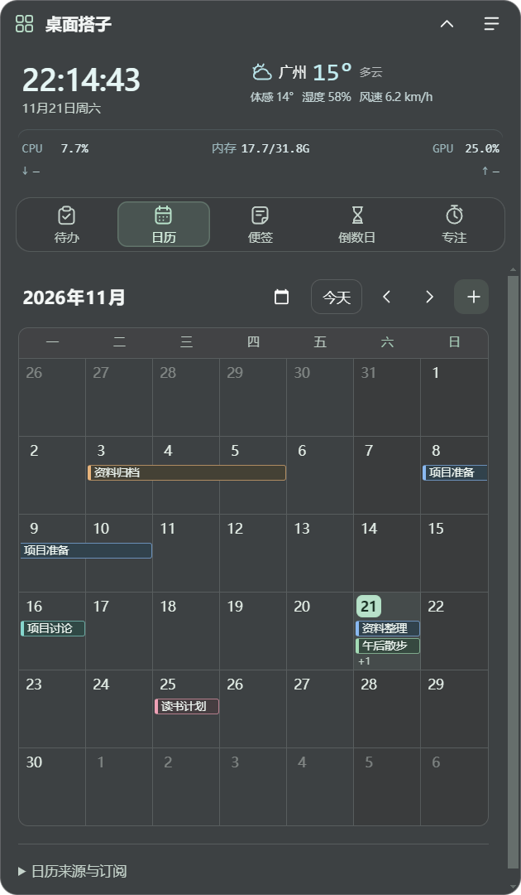</a></td>
  </tr>
</table>

新增的设置版本号截图来自v2.8.4的隔离实际窗口，开发宿主按Electron官方启动流程，从应用清单初始化版本。正式包另核对了内置清单、构建文件和哈希，未操作个人正式窗口。专注计时与倒数日截图来自v2.8.3；其余设置与收纳截图来自v2.8.2，当天清单来自v2.8.1，其他界面来自v2.8.0。

为避免公开私人内容，文件、待办、便签和日程使用本机实际创建的公开演示资料；桌面面板的时钟采用截图当日系统时间，设备读数来自本机，没有替换成固定样本。外观设置中的时钟和文件是界面已标明的效果预览样例。天气截图使用当时实际读取的广州天气和三日预报，没有用固定数值替代。

## 最近更新

| 版本 | 发布日期（北京时间） | 主要变化 |
| --- | --- | --- |
| v2.8.8 | 2026-11-23 | 置顶图标拖动让位，外观透明度实时联动。 |
| v2.8.4 | 2026-11-22 | 设置底栏显示实际运行版本，窄窗口也能查看。 |
| v2.8.3 | 2026-11-22 | 个人倒数日与节日卡片统一大小；修复专注多显示一秒；隔离测试通知。 |
| v2.8.2 | 2026-11-21 | 设置与收纳布局更紧凑，分区操作同排，设置导航保持可见。 |
| v2.8.1 | 2026-11-21 | 当天日程清单改为每项一行，浮窗更紧凑。 |
| v2.8.0 | 2026-11-21 | 月历显示连续跨天横条；点击先看详情，按需编辑；补充地点与备注。 |
| v2.7.2 | 2026-11-21 | 日历事项、当天清单和新建表单改用浮窗。 |
| v2.7.1 | 2026-11-21 | 倒数日固定三列；月历格显示彩色事项；修复天气等待和托盘重开。 |
| v2.7.0 | 2026-11-20 | 圆润图标与统一排版；彩色日程；常用节日倒数；真实界面图库。 |
| v2.6.17 | 2026-11-15 | “全部”与置顶；按实际使用时段分配饮水量；独立撤销；启动吸附修复。 |

[查看完整更新日志](CHANGELOG.md)，包括每版新增、调整、修复、验证记录和当前已知问题。升级前从系统托盘退出旧版；打开新版后，可在设置底栏确认版本。

## 它能帮你做什么

| 功能 | 日常怎么用 |
| --- | --- |
| 文件收纳 | 默认打开“全部”，也可切换应用、文件、图片、影音。支持搜索、筛选、排序和多选分类；拖入文件只添加引用，原文件位置不变。 |
| 常用项目置顶 | 右键应用、文件或图片选择“置顶”，在全部及所属分类中优先显示，重启后保留；双击打开，右键可取消置顶。 |
| 待办与提醒 | 按待办、今天、计划、已完成查看事项。点击文字直接改名，点击铃铛设置安排日期、具体时间和提醒。 |
| 日历与倒数日 | 月历显示彩色事项和连续跨天横条，点击先看详情，再选择编辑；添加自己的生日、纪念日和交付日期；同时查看春节、端午、中秋等常用节日的倒数。 |
| 喝水与活动 | 按剩余目标和使用时段分配喝水量，点击水杯记录当前量；活动后点击脊柱图标。两边各有独立的15秒撤销。 |
| 其他桌面工具 | 便签、世界时钟、多城市天气、专注计时、设备读数，以及面板显隐、透明度、配色和布局备份。 |

## 快速上手

1. **展开收纳框，置顶常用项目。** 打开软件后进入“全部”。右键常用应用选择“置顶”，以后直接在前面双击打开；文件也可拖入分类栏或列表添加引用。
2. **把今天的安排放到桌面。** 在待办页添加事项；在日历页点击右上角“+”新增，或点击日期，在浮窗里选择“新建日程”；填写事项、时间并选色。点击月历彩色事项先看详情，再点击“编辑日程”修改；地点和备注均可选填。倒数日会显示近期节日，也能添加自己的重要日期。
3. **按自己的节奏设置提醒。** 点击“桌面搭子”右上角的设置按钮，在“健康”里设置每日目标、结束时间与提醒方式。喝水后点水杯，活动后点脊柱图标；误点时在15秒内分别撤销。

希望开机就能用，可在 **设置 → 桌面 → 组件** 开启“开机启动”。点击系统托盘中的“桌面搭子”图标可以重新显示面板。

查看当前软件版本：打开 **设置**，在底栏右侧查看“版本 x.y.z”。

## 下载与安装

| 版本 | 下载 | 适合谁 |
| --- | --- | --- |
| 安装版 | [Windows x64 安装版](https://github.com/Gerson369/windows-desktop-widgets/releases/download/v2.8.8/windows-desktop-widgets-2.8.8-x64-setup.exe) | 长期在这台电脑使用，按安装向导操作。 |
| 免安装版 | [Windows x64 免安装版](https://github.com/Gerson369/windows-desktop-widgets/releases/download/v2.8.8/windows-desktop-widgets-2.8.8-x64-portable.exe) | 下载后直接运行，不经过安装向导。 |
| 文件校验 | [SHA256SUMS.txt](https://github.com/Gerson369/windows-desktop-widgets/releases/download/v2.8.8/SHA256SUMS.txt) | 核对下载文件是否完整。 |

两种版本功能相同，沿用已有本地数据目录与配置格式。免安装版的数据也按应用设置保存在本机，不会自动随 exe 文件移动。软件未配置代码签名，Windows 可能显示发布者提示。

## 真实界面

下面为各图所标版本的软件实际窗口截图。点击图片可查看原图。

<p><strong>设置版本：底栏右侧显示当前运行版本</strong><br /><a href="docs/images/v2.8.4/settings-version.png">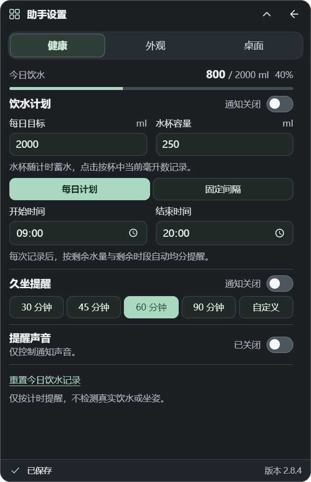</a><br /><a href="docs/images/v2.8.4/settings-version-300.png">查看300px窄窗口</a></p>

<p><strong>当天清单：每项一行，点击名称查看完整详情</strong><br /><a href="docs/images/v2.8.1/calendar-day-list-420.png">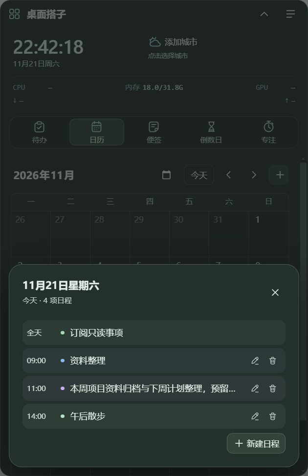</a></p>

<table>
  <tr>
    <td width="50%" valign="top"><strong>待办：记下一件事，安排时间，再逐项完成</strong><br /><a href="docs/images/v2.8.0/todos.png">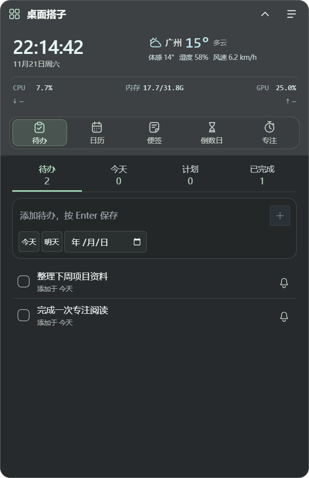</a></td>
    <td width="50%" valign="top"><strong>倒数日：节日与自己的重要日子紧凑排列</strong><br /><a href="docs/images/v2.8.3/countdown.png">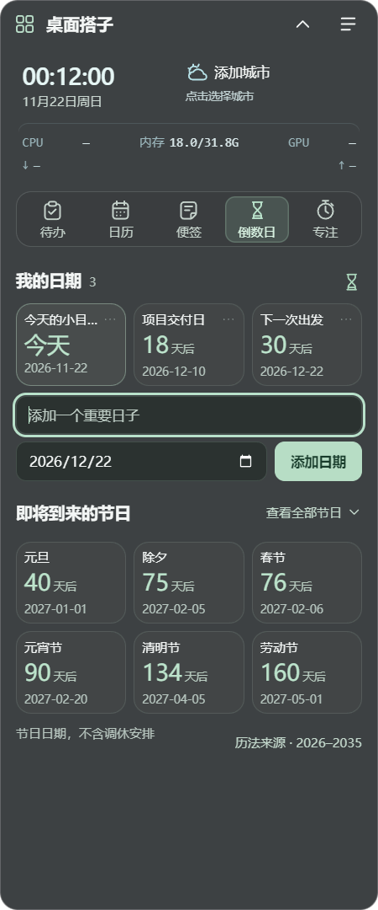</a></td>
  </tr>
  <tr>
    <td width="50%" valign="top"><strong>事项详情：底部浮窗展示时间、地点和备注</strong><br /><a href="docs/images/v2.8.0/calendar-detail.png">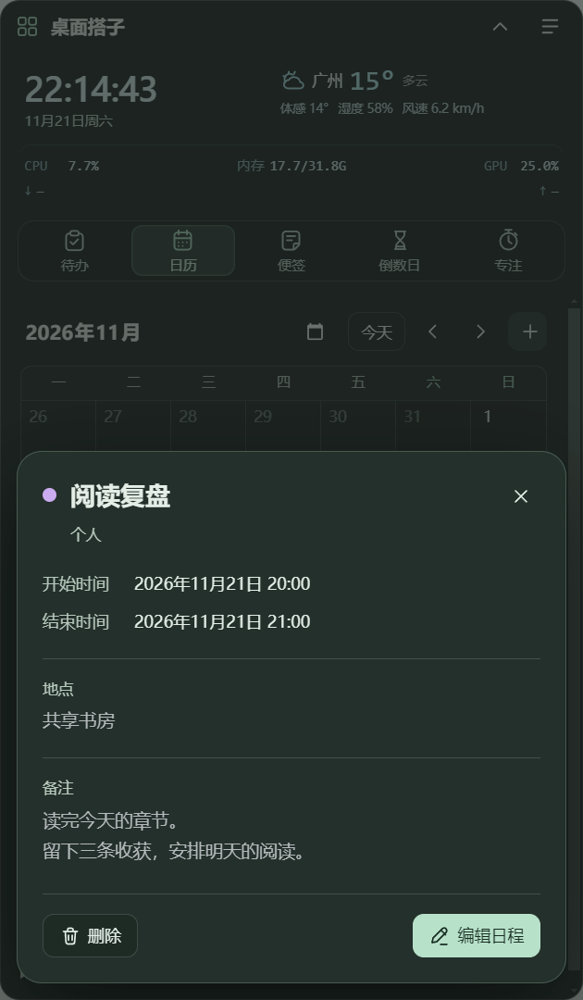</a></td>
    <td width="50%" valign="top"><strong>编辑日程：修改内容、时间、颜色和跨天日期</strong><br /><a href="docs/images/v2.8.0/calendar-editor.png">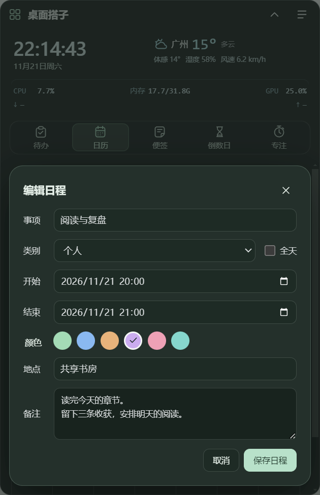</a></td>
  </tr>
  <tr>
    <td width="50%" valign="top"><strong>外观设置：缩小预览，透明度、颜色与字号集中调整</strong><br /><a href="docs/images/v2.8.2/settings-appearance.png">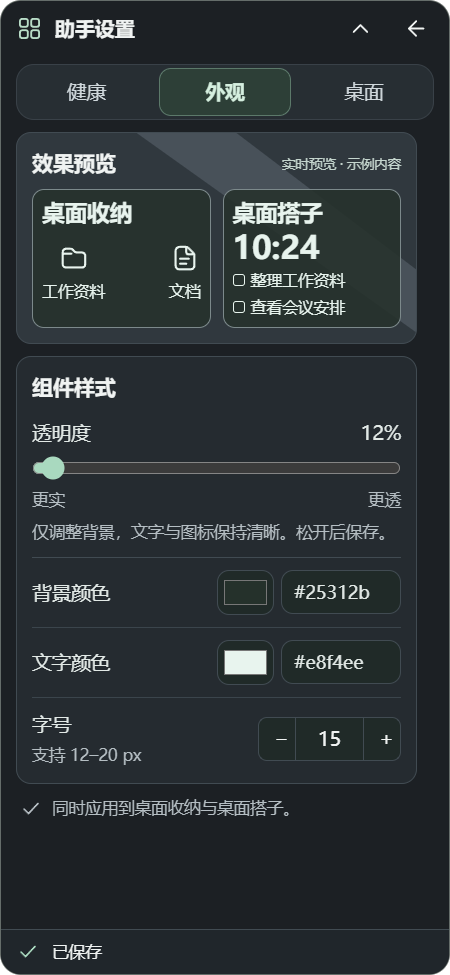</a></td>
    <td width="50%" valign="top"><strong>收纳设置：分区名称、数量与开关放在同一行</strong><br /><a href="docs/images/v2.8.2/settings-organizer.png">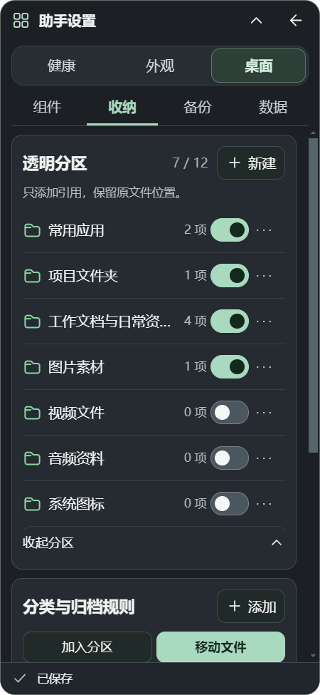</a></td>
  </tr>
  <tr>
    <td width="50%" valign="top"><strong>便签：随手写下内容，自动保存到本机</strong><br /><a href="docs/images/v2.8.0/notes.png">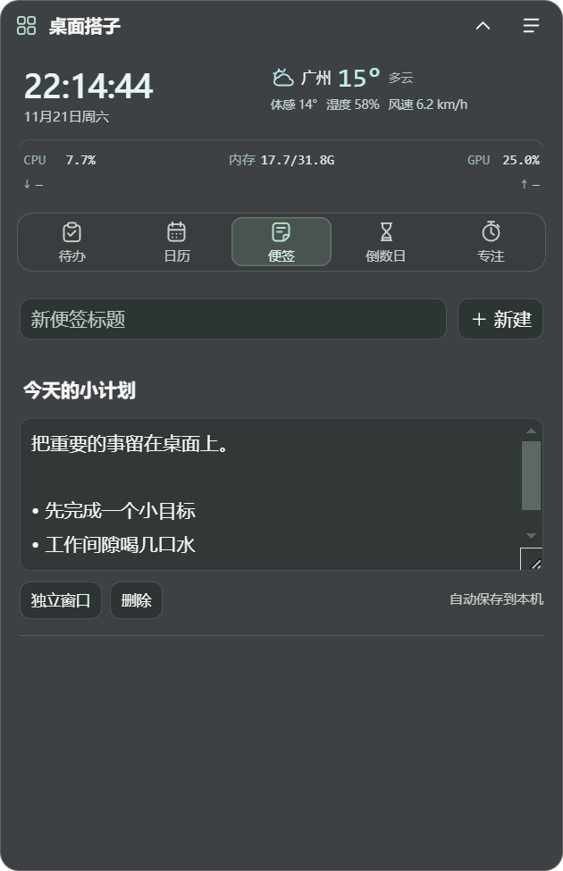</a></td>
    <td width="50%" valign="top"><strong>设置：喝水目标、时段和间隔集中调整</strong><br /><a href="docs/images/v2.8.2/settings-health.png">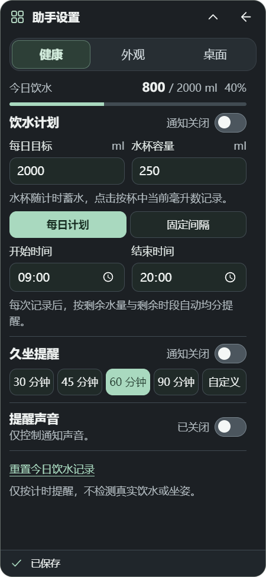</a></td>
  </tr>
  <tr>
    <td width="50%" valign="top"><strong>健康面板：查看杯量、已喝与剩余目标</strong><br /><a href="docs/images/v2.8.0/health.png"></a></td>
    <td width="50%" valign="top"><strong>天气：真实读取当前天气与三日预报</strong><br /><a href="docs/images/v2.8.0/weather.png">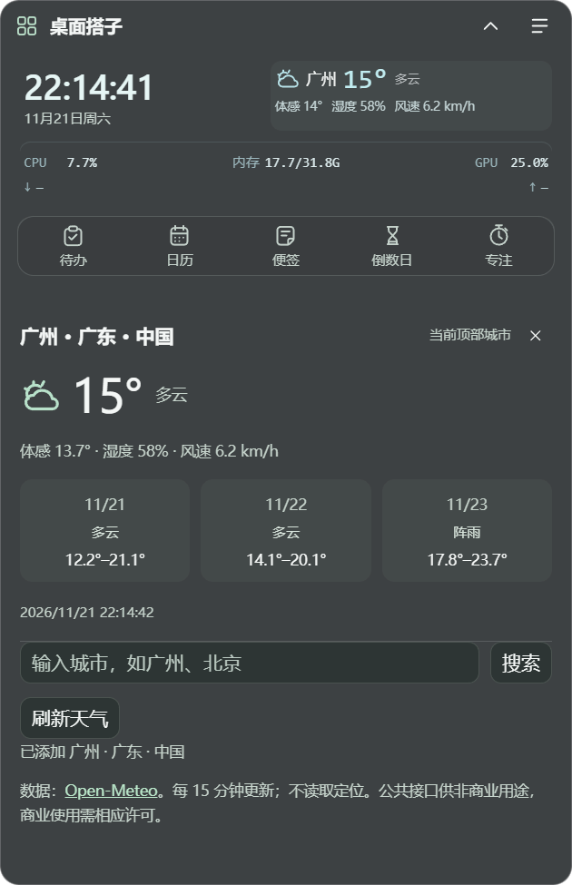</a></td>
  </tr>
</table>

组件显隐、显示器选择和桌面行为集中在[组件设置](docs/images/v2.8.2/settings-components.png)。[专注计时实际界面](docs/images/v2.8.3/focus.png)展示正常开始后的25:00。

## 喝水量怎么算

固定间隔模式会按 **剩余目标水量 ÷ 从本轮实际开始计时到设定结束时间的提醒次数** 分配满杯量。晚开电脑时从实际开始时间计算；早于设置的开始时间时，按设置的开始时间分配。

例如当天目标2L、尚未记录喝水、11:00开始、20:00结束、每15分钟提醒一次：9小时共36次，本轮满杯约56ml。水杯随计时蓄水，半个间隔约28ml，此时点击只记录28ml；下一轮会按剩余水量与时段重新分配。每次显示取整，末杯不超过剩余目标，临近结束不强制补足。

“每日计划”则由你设置水杯容量，软件按剩余水量和时段安排下一次提醒。两种模式共用当天记录，重启后保留已喝水量并重新计时。喝水和活动各自保留最近一次15秒撤销，同一项再次完成时只保留该项的新撤销。

图示只基于计时，不检测真实坐姿或饮水；饮水目标由你设置，分配结果不是个体饮水建议。

## 节日与日历说明

个人倒数日和节日卡片大小一致，均为三列；点击个人日期右上角“更多”可编辑或删除。

倒数日目前有三项已知问题，v2.8.4尚未修复：

- “更多”菜单打开后再缩小窗口或滚动，菜单可能越过窗口边缘或脱离原卡片。
- 编辑某个倒数日后将它删除，再保存仍打开的编辑表单，会重新写回已删除的项目。
- 保存等待期间继续输入，旧保存成功后可能清空新输入的草稿。

内置节日资料覆盖 **2026–2035年**，日期依据[香港天文台公历与农历日期对照表](https://www.hko.gov.hk/tc/gts/time/conversion1_text.htm)核对。这里展示的是节日当天与倒数，不是国务院调休或工作日安排。个人倒数日不受内置节日年份表限制。

日历按周显示整个月，也显示相邻月份的补齐日期。跨天日程在同一周内连成横条，跨周时分段延续；同一天超过两条时显示“+N”，点击日期或“+N”查看当天完整清单。每项一行显示时间、颜色和名称，右侧保留操作按钮；长名称省略显示，悬停或点击查看完整内容。

点击事项先打开底部详情浮窗，展示起止时间、来源，以及已填写的地点与备注。点击“编辑日程”再修改；保存、取消或按 Esc 返回月历，保存失败保留输入。全天安排的结束日期包含当天。地点与备注以纯文本保存在本机。

日程也可导入ICS或添加HTTPS日历订阅，支持显示其中的地点与说明。订阅为只读合并展示，每30分钟检查更新；导入文件变化后需要重新导入。

## 升级与本地数据

1. 从系统托盘右键菜单选择 **退出**，等待原桌面图标恢复。收起或隐藏面板不等于退出程序。
2. 安装新版或打开新版免安装文件，继续使用原有本地数据目录；打开设置，确认底栏显示版本 2.8.8。不需要为了升级删除配置。
3. 升级前如需备份，可在 **设置 → 桌面 → 数据** 导出全部数据。导入备份会替换当前配置，请先保留现有备份。

待办、便签、计划、饮水记录、置顶与布局保存在本机。导出文件可能包含便签正文、文件路径和私人日历订阅地址，请妥善保管，勿提交到公共仓库。收纳分类与拖入引用不移动原文件；只有明确选择移动文件、重命名或回收站操作时才执行相应操作。

天气使用Open-Meteo，只发送所选城市坐标，不自动读取定位；日历订阅访问你添加的地址。天气服务有相应服务与商业条款。GPU、网络和电池读数受Windows及设备支持程度影响；工作区过小时可将健康面板拖开单独摆放。

## 从源码运行

需要Node.js与Windows构建环境。首次安装依赖后启动：

```powershell
npm ci
npm run build:native
npm run dev
```

验证和构建：

```powershell
npm run typecheck
npm test
npm run build
npm run dist:windows
```

`dist:windows`编译原生桥，并把安装版和免安装版生成到`release/`。真实窗口截图与关键操作检查可运行：

```powershell
node tests/ui-gallery.mjs
node tests/calendar-popup.mjs
node tests/settings-compact.mjs
node tests/focus-timer.mjs
```

该脚本使用独立数据目录，实际创建公开演示文件与事项，不读写你的个人配置，也不隐藏或移动真实桌面文件。

## 验证与反馈

v2.8.8 已通过 152 项单元与契约检查、类型检查和生产构建，并在实际测试窗口验证置顶拖动、滚动位置与本地文件的透明拖动预览。免安装版已启动并验证收纳窗口正常加载。

v2.8.3已有151项单元与契约检查、类型检查和生产构建的通过记录；专注计时验收包含隔离主进程时钟的边界模拟，以及真实3秒自然归零，通知只记录到独立日志。其余功能沿用各图标明版本的验证记录，倒数日已知问题见上文。

本次未复测完整25分钟计时、安装向导覆盖升级、真实锁屏、多屏热插拔和全天连续运行。更多结果见[当前版本更新说明](https://github.com/Gerson369/windows-desktop-widgets/releases/tag/v2.8.8)。

遇到问题请在[Issues](https://github.com/Gerson369/windows-desktop-widgets/issues)提供Windows版本、软件版本、操作步骤、预期与实际结果，并附必要截图。截图和附件请先检查是否含私人内容，不要上传完整个人配置。

[MIT许可证](LICENSE)。依赖与第三方服务遵循各自许可证和条款。
