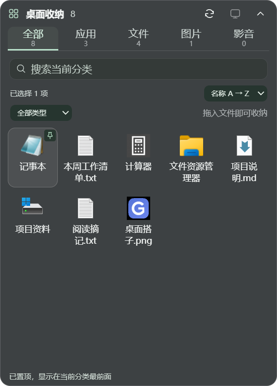
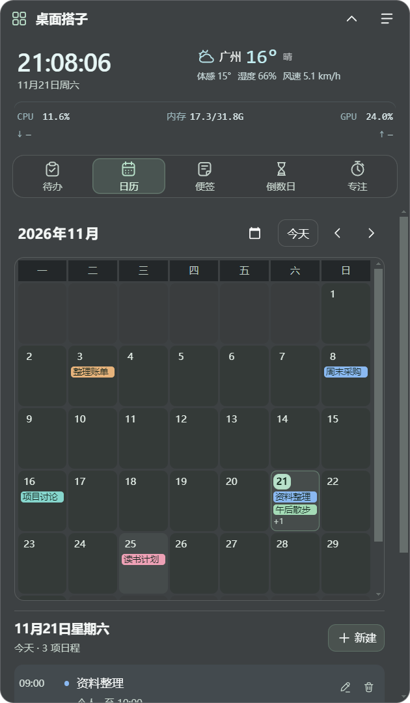
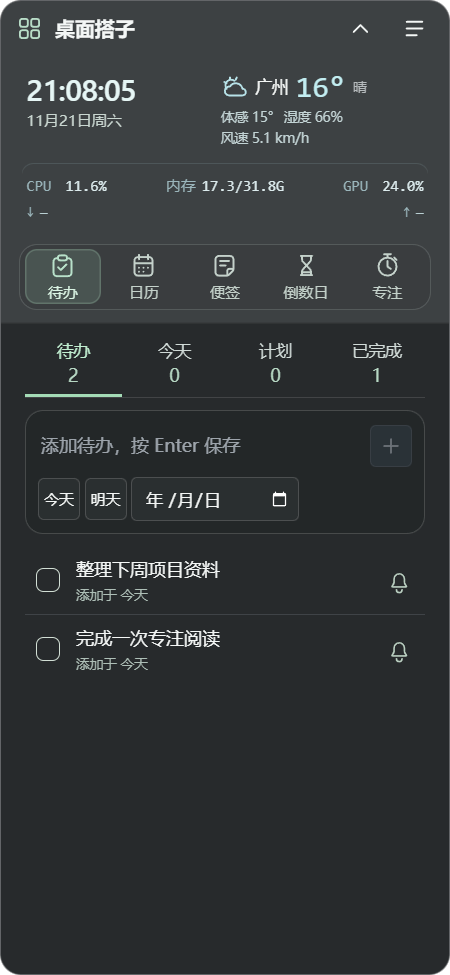
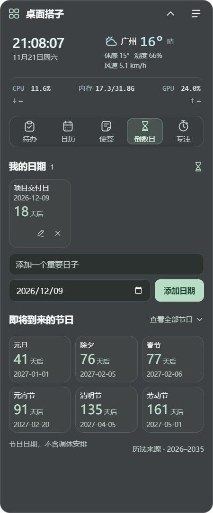
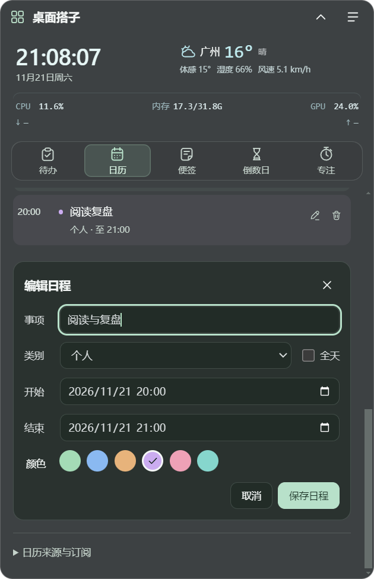
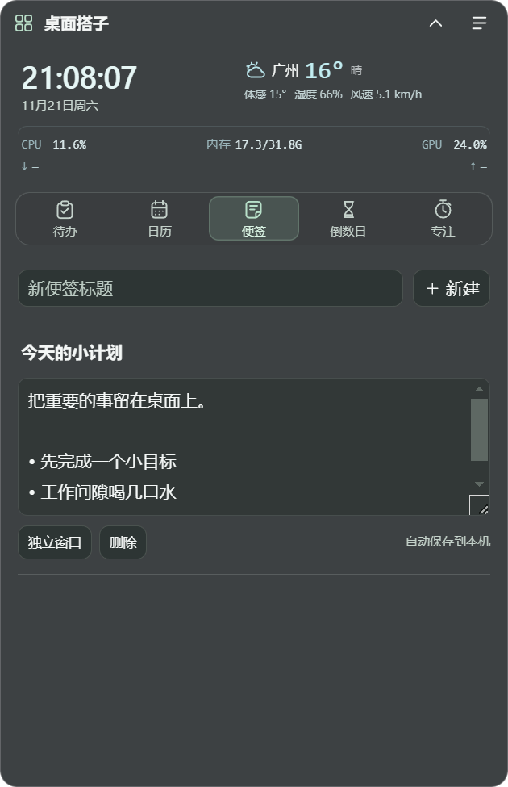
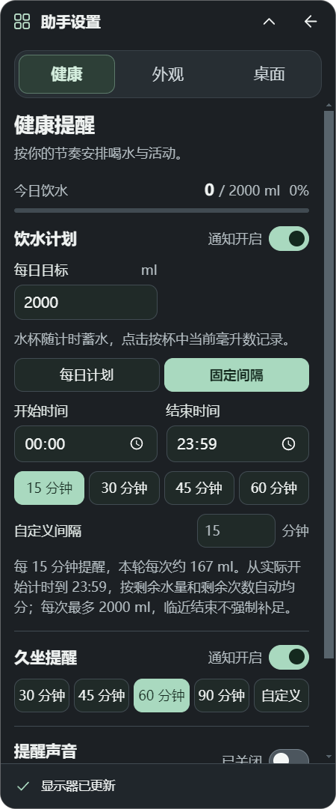
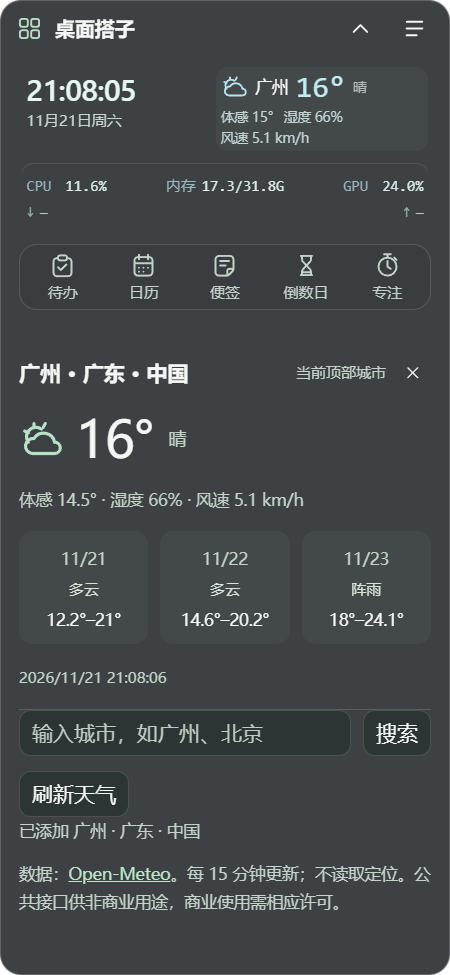

# 桌面搭子

**常用软件随手开，今天要做的事和重要日子，就放在桌面上。**

桌面搭子是 Windows 桌面工具箱，把文件收纳、待办、日历、节日倒数和喝水活动提醒放进几个小面板。常用项目可以置顶后双击打开，面板可拖动、收起和吸附，数据保存在本机。

**Windows 10 / 11 x64 · v2.7.1 · MIT 开源**

[下载最新版](https://github.com/Gerson369/windows-desktop-widgets/releases/latest) · [快速上手](#快速上手) · [真实界面](#真实界面) · [更新说明](https://github.com/Gerson369/windows-desktop-widgets/releases/tag/v2.7.1) · [反馈问题](https://github.com/Gerson369/windows-desktop-widgets/issues)

<table>
  <tr>
    <td width="50%" valign="top"><strong>桌面收纳：常用项目置顶，双击就能打开</strong><br /><a href="docs/images/v2.7.1/collection.png"></a></td>
    <td width="50%" valign="top"><strong>日历月视图：事项直接显示在日期格里</strong><br /><a href="docs/images/v2.7.1/calendar-agenda.png"></a></td>
  </tr>
</table>

本页图片直接截取自 v2.7.1 实际运行窗口。为避免公开私人内容，文件、待办、便签和日程使用本机实际创建的公开演示资料；时钟采用截图当日系统时间，设备读数来自本机，没有替换成固定样本。天气截图使用当时实际读取的广州天气和三日预报，没有用固定数值替代。

## v2.7.1 更新

- **窄窗口也是三列倒数日**：自定义日期和节日都固定每行三列，缩小数字、文字与间距；六个节日只占两排，编辑和删除仍可操作。
- **事项直接显示在月历格里**：每一天显示彩色事项短条，超过两项显示剩余数量；点击日期查看完整列表，继续新增、编辑和选色。
- **天气等待有明确结束**：短暂断连自动重试一次；失败后结束加载，可以手动刷新，已有缓存会明确标识。
- **关闭窗口后能从托盘找回**：单击、双击或右键选择“打开桌面搭子”，都会重新显示并展开助手，而不只是恢复收纳框。

## 它能帮你做什么

| 功能 | 日常怎么用 |
| --- | --- |
| 文件收纳 | 默认打开“全部”，也可切换应用、文件、图片、影音。支持搜索、筛选、排序和多选分类；拖入文件只添加引用，原文件位置不变。 |
| 常用项目置顶 | 右键应用、文件或图片选择“置顶”，在全部及所属分类中优先显示，重启后保留；双击打开，右键可取消置顶。 |
| 待办与提醒 | 按待办、今天、计划、已完成查看事项。点击文字直接改名，点击铃铛设置安排日期、具体时间和提醒。 |
| 日历与倒数日 | 查看当天彩色日程，添加自己的生日、纪念日和交付日期；同时查看春节、端午、中秋等常用节日的倒数。 |
| 喝水与活动 | 按剩余目标和使用时段分配喝水量，点击水杯记录当前量；活动后点击脊柱图标。两边各有独立的15秒撤销。 |
| 其他桌面工具 | 便签、世界时钟、多城市天气、专注计时、设备读数，以及面板显隐、透明度、配色和布局备份。 |

## 快速上手

1. **展开收纳框，置顶常用项目。** 打开软件后进入“全部”。右键常用应用选择“置顶”，以后直接在前面双击打开；文件也可拖入分类栏或列表添加引用。
2. **把今天的安排放到桌面。** 在待办页添加事项；在日历页选中日期后点击“新建”，填写事项和时间，再选一个颜色。倒数日会显示近期节日，也能添加自己的重要日期。
3. **按自己的节奏设置提醒。** 点击“桌面搭子”右上角的设置按钮，在“健康”里设置每日目标、结束时间与提醒方式。喝水后点水杯，活动后点脊柱图标；误点时在15秒内分别撤销。

希望开机就能用，可在 **设置 → 桌面 → 组件** 开启“开机启动”。点击系统托盘中的“桌面搭子”图标可以重新显示面板。

## 下载与安装

| 版本 | 下载 | 适合谁 |
| --- | --- | --- |
| 安装版 | [Windows x64 安装版](https://github.com/Gerson369/windows-desktop-widgets/releases/download/v2.7.1/windows-desktop-widgets-2.7.1-x64-setup.exe) | 长期在这台电脑使用，按安装向导操作。 |
| 免安装版 | [Windows x64 免安装版](https://github.com/Gerson369/windows-desktop-widgets/releases/download/v2.7.1/windows-desktop-widgets-2.7.1-x64-portable.exe) | 下载后直接运行，不经过安装向导。 |
| 文件校验 | [SHA256SUMS.txt](https://github.com/Gerson369/windows-desktop-widgets/releases/download/v2.7.1/SHA256SUMS.txt) | 核对下载文件是否完整。 |

两种版本功能相同，沿用已有本地数据目录与配置格式。免安装版的数据也按应用设置保存在本机，不会自动随 exe 文件移动。软件未配置代码签名，Windows 可能显示发布者提示。

## 真实界面

下面均为新版软件的实际窗口截图。点击图片可查看原图。

<table>
  <tr>
    <td width="50%" valign="top"><strong>待办：记下一件事，安排时间，再逐项完成</strong><br /><a href="docs/images/v2.7.1/todos.png"></a></td>
    <td width="50%" valign="top"><strong>倒数日：节日与自己的重要日子紧凑排列</strong><br /><a href="docs/images/v2.7.1/countdown.png"></a></td>
  </tr>
  <tr>
    <td width="50%" valign="top"><strong>日程编辑：名称、时间和颜色按顺序填写</strong><br /><a href="docs/images/v2.7.1/calendar-editor.png"></a></td>
    <td width="50%" valign="top"><strong>便签：随手写下内容，自动保存到本机</strong><br /><a href="docs/images/v2.7.1/notes.png"></a></td>
  </tr>
  <tr>
    <td width="50%" valign="top"><strong>设置：喝水目标、时段和间隔集中调整</strong><br /><a href="docs/images/v2.7.1/settings.png"></a></td>
    <td width="50%" valign="top"><strong>健康面板：查看杯量、已喝与剩余目标</strong><br /><a href="docs/images/v2.7.1/health.png"></a></td>
  </tr>
</table>

<p><strong>天气：真实读取当前天气与三日预报</strong><br /><a href="docs/images/v2.7.1/weather.png"></a></p>

## 喝水量怎么算

固定间隔模式会按 **剩余目标水量 ÷ 从本轮实际开始计时到设定结束时间的提醒次数** 分配满杯量。晚开电脑时从实际开始时间计算；早于设置的开始时间时，按设置的开始时间分配。

例如当天目标2L、尚未记录喝水、11:00开始、20:00结束、每15分钟提醒一次：9小时共36次，本轮满杯约56ml。水杯随计时蓄水，半个间隔约28ml，此时点击只记录28ml；下一轮会按剩余水量与时段重新分配。每次显示取整，末杯不超过剩余目标，临近结束不强制补足。

“每日计划”则由你设置水杯容量，软件按剩余水量和时段安排下一次提醒。两种模式共用当天记录，重启后保留已喝水量并重新计时。喝水和活动各自保留最近一次15秒撤销，同一项再次完成时只保留该项的新撤销。

图示只基于计时，不检测真实坐姿或饮水；饮水目标由你设置，分配结果不是个体饮水建议。

## 节日与日历说明

内置节日资料覆盖 **2026–2035年**，日期依据[香港天文台公历与农历日期对照表](https://www.hko.gov.hk/tc/gts/time/conversion1_text.htm)核对。这里展示的是节日当天与倒数，不是国务院调休或工作日安排。个人倒数日不受内置节日年份表限制。

日历月视图的每个日期格内直接显示最多两条彩色事项短条，超出时显示“+N”；点击日期仍可查看全部事项。日程可在本机创建、编辑、选色和删除，也可导入ICS或添加HTTPS日历订阅。订阅为只读合并展示，每30分钟检查更新；导入文件变化后需要重新导入。

## 升级与本地数据

1. 从系统托盘右键菜单选择 **退出**，等待原桌面图标恢复。收起或隐藏面板不等于退出程序。
2. 安装新版或打开新版免安装文件，继续使用原有本地数据目录，不需要为了升级删除配置。
3. 升级前如需备份，可在 **设置 → 桌面 → 数据** 导出全部数据。导入备份会替换当前配置，请先保留现有备份。

待办、便签、计划、饮水记录、置顶与布局保存在本机。导出文件可能包含便签正文、文件路径和私人日历订阅地址，请妥善保管，勿提交到公共仓库。收纳分类与拖入引用不移动原文件；只有明确选择移动文件、重命名或回收站操作时才执行相应操作。

天气使用Open-Meteo，只发送所选城市坐标，不自动读取定位；日历订阅访问你添加的地址。天气服务有相应服务与商业条款。GPU、网络和电池读数受Windows及设备支持程度影响；工作区过小时可将健康面板拖开单独摆放。

## 从源码运行

需要Node.js与Windows构建环境。首次安装依赖后启动：

```powershell
npm ci
npm run build:native
npm run dev
```

验证和构建：

```powershell
npm run typecheck
npm test
npm run build
npm run dist:windows
```

`dist:windows`编译原生桥，并把安装版和免安装版生成到`release/`。真实窗口截图与关键操作检查可运行：

```powershell
node tests/ui-gallery.mjs
```

该脚本使用独立数据目录，实际创建公开演示文件与事项，不读写你的个人配置，也不隐藏或移动真实桌面文件。

## 验证与反馈

v2.7.1已通过144项单元与契约检查、类型检查和生产构建。真实Electron窗口检查覆盖窄窗口固定三列倒数日、关闭后重新打开助手、300px与420px日程表单、事项选色及新增编辑、收纳置顶、待办完成和便签保存；截图采用真实时钟与设备采样。更多验证结果见[当前版本更新说明](https://github.com/Gerson369/windows-desktop-widgets/releases/tag/v2.7.1)。界面截图使用独立数据，不能代表全部硬件条件。本轮未覆盖安装向导覆盖升级、真实多屏热插拔和全天连续运行。

遇到问题请在[Issues](https://github.com/Gerson369/windows-desktop-widgets/issues)提供Windows版本、软件版本、操作步骤、预期与实际结果，并附必要截图。截图和附件请先检查是否含私人内容，不要上传完整个人配置。

[MIT许可证](LICENSE)。依赖与第三方服务遵循各自许可证和条款。
