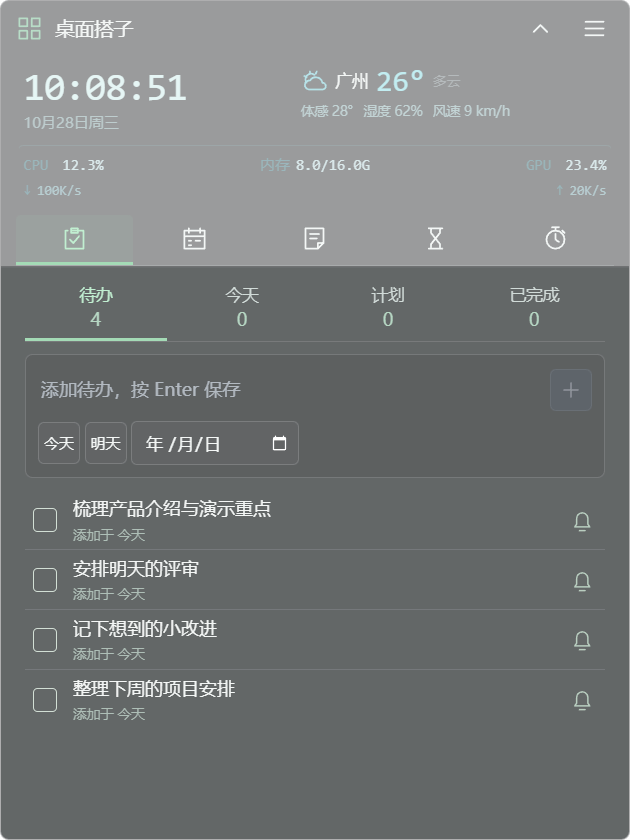

# 桌面搭子

**帮你整理桌面、记下待办，到点提醒你喝水、起来动动。**

桌面文件越堆越多，想到的事转头就忘，工作一忙又忘了喝水和起身。桌面搭子把文件收纳、待办和日常提醒放在 Windows 桌面上，让常用资料更好找，要做的事随手记。

适用于 **Windows 10 / 11 x64**，提供安装版与免安装版。

[下载最新版](https://github.com/Gerson369/windows-desktop-widgets/releases/latest) · [反馈问题](https://github.com/Gerson369/windows-desktop-widgets/issues)

## 它能帮你做什么

- **文件各归各类，找起来更方便**：应用、文件、图片、影音分开收纳，支持分类内搜索、筛选和排序。分类收纳保留原文件位置，通过托盘退出后恢复原桌面图标。
- **想到就记，安排好再做**：在桌面直接添加待办，按“待办 / 今天 / 计划 / 已完成”查看；支持安排日期、设置提醒、原地改名和完成后恢复。
- **忙起来，也记得喝水和活动**：喝水、久坐分别计时提醒；每日喝水目标、杯量和每杯时间可以自己安排。点击图标记录，最近一次操作可在 15 秒内撤销；锁屏和休眠时暂停提醒计时。
- **让提醒看得见**：水杯会随计时逐渐蓄满，超时后溢水、积水；久坐提醒的脊柱图标会逐渐弯曲，超时后骨节松动、逐节掉落。图示基于计时，不检测真实坐姿或饮水。
- **日常要看的信息，就放在桌面**：查看时钟、多城市天气和设备读数；日历、便签、倒数日和专注计时可在综合助手里切换。
- **按自己的习惯摆放和保存**：拖动吸附、主题颜色、背景透明度和布局可调整。待办、便签、计划与布局保存在本机，也能导出配置备份。

<p align="center"></p>

截图使用演示事项和固定天气、设备样本，并非实时数据。

## 安装

在 [Releases](https://github.com/Gerson369/windows-desktop-widgets/releases/latest) 下载：

- `setup.exe`：安装版。
- `portable.exe`：免安装版。

已发布的 v2.4.0 安装包仍使用旧名称「Gerson 桌面助手」；后续发布采用「桌面搭子」。

更新前从系统托盘退出旧版，再打开新版。请通过托盘退出以便恢复桌面图标；隐藏面板不等于退出程序。未配置代码签名，Windows 可能显示发布者提示。

## 从源码运行

技术栈：Electron、Vue 3、TypeScript 与 C# 原生桌面桥接。

需要 Windows x64、Node.js 22 LTS（附 npm）、Windows 自带的 .NET Framework 4.x C# 编译器。首次安装依赖和打包需要网络。

```powershell
git clone https://github.com/Gerson369/windows-desktop-widgets.git
cd windows-desktop-widgets
npm ci
npm run build:native
npm run dev
```

验证和构建：

```powershell
npm run typecheck
npm test
npm run build
npm run dist:windows
```

`dist:windows` 会编译两个原生桥，生成 Windows x64 安装版和免安装版到 `release/`。原生二进制、依赖、构建输出及本机测试数据不提交到仓库。

## 项目结构

```text
src/main/         Electron 主进程、本地数据、桌面与提醒逻辑
src/preload/      隔离的 IPC 接口
src/renderer/     Vue 界面与桌面组件
native/           C# 桌面挂接及布局桥接源码
scripts/          构建与隔离交互验证工具
tests/            单元测试、契约与数据保护测试
```

## 数据与边界

天气使用 Open-Meteo，仅发送选择的城市坐标，不读取自动定位；日历订阅访问你自己添加的地址。天气接口有服务与商业使用条款，商业使用前请确认相应许可。GPU、网络和电池读数受 Windows 与设备支持程度影响；健康图示仅基于计时，不能检测真实坐姿或饮水。

导出的配置可能包含私人便签、文件路径和日历订阅地址，请勿提交到公共仓库。此仓库不包含个人配置、凭据、桌面文件清单、第三方桌面软件拆包或本机测试记录。

当前版本：**2.4.0**。单元及契约测试 79 项通过；界面交互在隔离 Windows 实例验证。多屏、特殊桌面环境和长时间运行仍需要更多设备验证。

## 许可证

[MIT](LICENSE)。依赖及第三方服务遵循各自许可证和服务条款。
