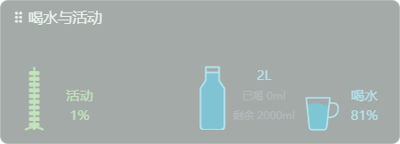
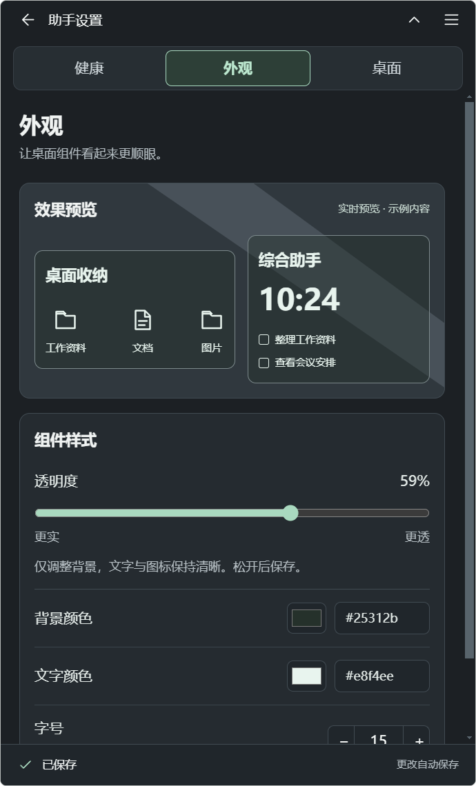

# 桌面搭子

**帮你整理桌面、记下待办，到点提醒你喝水、起来动动。**

桌面文件越堆越多，想到的事转头就忘，工作一忙又忘了喝水和起身。桌面搭子把文件收纳、待办和日常提醒放在 Windows 桌面上，让常用资料更好找，要做的事随手记。

适用于 **Windows 10 / 11 x64**，当前版本 **v2.6.9**，提供安装版与免安装版。

[下载最新版](https://github.com/Gerson369/windows-desktop-widgets/releases/latest) · [反馈问题](https://github.com/Gerson369/windows-desktop-widgets/issues)

## 它能帮你做什么

- **文件各归各类，找起来更方便**：应用、文件、图片、影音分开收纳，支持分类内搜索、筛选和排序；切换分类保留搜索词，整理进度与操作结果直接显示。分类收纳保留原文件位置，通过托盘退出后恢复原桌面图标。
- **想到就记，安排好再做**：在桌面直接添加待办，按“待办 / 今天 / 计划 / 已完成”查看。新建时可选今天、明天或其他日期；点击铃铛统一调整安排日期、具体时间与提醒，逾期事项带有标识。
- **忙起来，也记得喝水和活动**：独立的“喝水与活动”面板可以单独摆放，也能贴靠收纳框或综合助手并跟随移动。每日目标、杯量和每杯时间可以自己安排，水瓶显示已喝与剩余水量；最近一次记录可在 15 秒内撤销。
- **让提醒看得见**：水杯会随计时逐渐蓄满，超时后溢水、水滴落下；久坐提醒的脊柱图标会逐渐弯曲，超时后骨节松动、逐节掉落。图示基于计时，不检测真实坐姿或饮水。
- **日常要看的信息，就放在桌面**：查看时钟、多城市天气和设备读数；日历、便签、倒数日和专注计时可在综合助手里切换。
- **按自己的习惯摆放和保存**：拖动吸附、主题颜色、背景透明度和布局可调整。待办、便签、计划与布局保存在本机，也能导出配置备份。

<p align="center"></p>
<p align="center"></p>

截图使用演示事项和固定天气、设备样本，并非实时数据。

## v2.6.9 更新

- **设置更好找**：健康、外观和桌面统一为深色薄荷界面；桌面设置再分为组件、收纳、备份和数据四组。
- **喝水计划更直观**：先看今日进度，再调整目标、杯量和时段；逐杯时间单独编辑，久坐自定义间隔按需展开。
- **外观边调边看**：透明度、背景色、文字色与字号同步预览；保存失败保留草稿和重试入口，其他操作成功不会掩盖未保存内容。
- **整理前先看结果**：分区和规则改为紧凑列表，添加表单按需展开；区分文件引用与实际移动，保留预览、确认和撤销。
- **健康面板更清楚**：去掉文字选中时的绿色底块；保持紧凑尺寸，修正贴靠时的尺寸约束和附着方向选择，隐藏或折叠父组件后重启仍保留已存贴靠关系。

<p align="center"></p>

## 安装

在 [Releases](https://github.com/Gerson369/windows-desktop-widgets/releases/latest) 下载：

- `setup.exe`：安装版。
- `portable.exe`：免安装版。

安装包使用「桌面搭子」名称，沿用旧版的数据目录与配置格式。

更新前从系统托盘退出旧版，再打开新版。请通过托盘退出以便恢复桌面图标；隐藏面板不等于退出程序。未配置代码签名，Windows 可能显示发布者提示。

## 从源码运行

技术栈：Electron、Vue 3、TypeScript 与 C# 原生桌面桥接。

需要 Windows x64、Node.js 22 LTS（附 npm）、Windows 自带的 .NET Framework 4.x C# 编译器。首次安装依赖和打包需要网络。

```powershell
git clone https://github.com/Gerson369/windows-desktop-widgets.git
cd windows-desktop-widgets
npm ci
npm run build:native
npm run dev
```

验证和构建：

```powershell
npm run typecheck
npm test
npm run build
npm run dist:windows
```

`dist:windows` 会编译两个原生桥，生成 Windows x64 安装版和免安装版到 `release/`。原生二进制、依赖、构建输出及本机测试数据不提交到仓库。

## 项目结构

```text
src/main/         Electron 主进程、本地数据、桌面与提醒逻辑
src/preload/      隔离的 IPC 接口
src/renderer/     Vue 界面与桌面组件
native/           C# 桌面挂接及布局桥接源码
scripts/          构建与隔离交互验证工具
tests/            单元测试、契约与数据保护测试
```

## 数据与边界

天气使用 Open-Meteo，仅发送选择的城市坐标，不读取自动定位；日历订阅访问你自己添加的地址。天气接口有服务与商业使用条款，商业使用前请确认相应许可。GPU、网络和电池读数受 Windows 与设备支持程度影响；健康图示仅基于计时，不能检测真实坐姿或饮水。

工作区过小时可能无法容纳贴靠组合，建议将健康面板拖开单独摆放。

导出的配置可能包含私人便签、文件路径和日历订阅地址，请勿提交到公共仓库。此仓库不包含个人配置、凭据、桌面文件清单、第三方桌面软件拆包或本机测试记录。

当前版本：**2.6.9**。98 项单元及契约测试、类型检查和生产构建通过；隔离数据窗口完成 300/360/460 像素宽度、最大字号预览、保存失败重试、备份恢复及导入取消等检查，共 21 项布局验证。发布包的版本、构建文件及 SHA256 已校验；本轮未实测安装向导覆盖升级、真实多屏和长时间运行。

## 许可证

[MIT](LICENSE)。依赖及第三方服务遵循各自许可证和服务条款。
